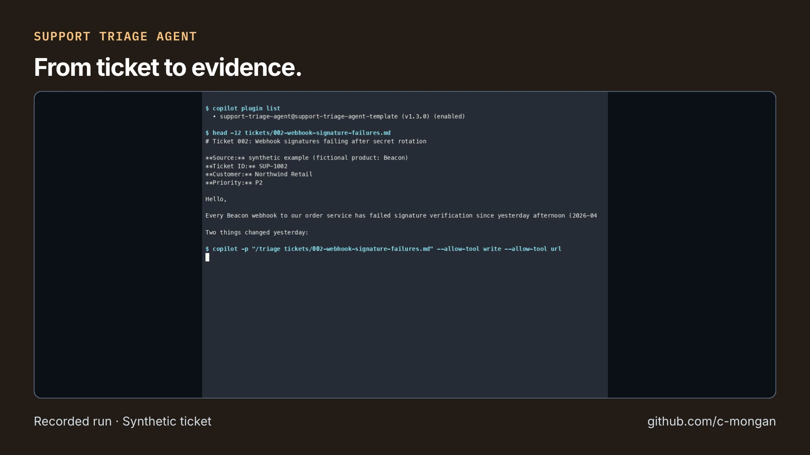

# Support Triage Agent: short video overview

[Watch on GitHub](https://github.com/c-mongan/support-triage-agent-template/releases/tag/portfolio-overview-2026-10-23) · [Download MP4](https://github.com/c-mongan/support-triage-agent-template/releases/download/portfolio-overview-2026-10-23/triage.mp4) · [Transcript](transcript.txt) · [Captions (SRT)](captions.srt) · [Captions (VTT)](captions.vtt)

Recorded CLI run using a synthetic ticket. Experimental; a support engineer reviews each result.

The video introduces the project; it does not replace its validation records or documented limits.

## Media details

- Duration: 21.233 seconds; 1920 × 1080; 30 fps; H.264 video and AAC audio.
- Published video SHA-256: `1be6bb7d058a66c2e5ccaac388ef287abebd0a23f38c9a2de079792d3acf4a87`.
- AI narration: Inworld TTS 2, using the voice selected by the project author.
- Music: *Happy Beats / Business Moves Vol. 10* by Sascha Ende (ende.app), licensed under [CC BY 4.0](https://github.com/spdx/license-list-data/blob/main/text/CC-BY-4.0.txt); see the [bundled music attribution](https://github.com/latent-spaces/brag/blob/99a49090808cff1f42ba1fc2f939ddbf7724a4a9/skills/brag/assets/music/README.md). The track is trimmed, faded, and mixed beneath speech.
- Story and video workflow: [Brag](https://github.com/latent-spaces/brag); rendered locally with [Hyperframes](https://github.com/heygen-com/hyperframes).

## Visual sources

- [README.md](https://github.com/c-mongan/support-triage-agent-template/blob/83925db1ddfefac0dd4313a6ba6c12f2d002baee/README.md) — source Git blob `86446828816871446920cf27c603a799dbb12ce5`.
- [triage-session.gif](https://github.com/c-mongan/support-triage-agent-template/blob/83925db1ddfefac0dd4313a6ba6c12f2d002baee/docs/demo/triage-session.gif) — source Git blob `31fdde0b57407308d2229b7bdc572db82760bedf`.
